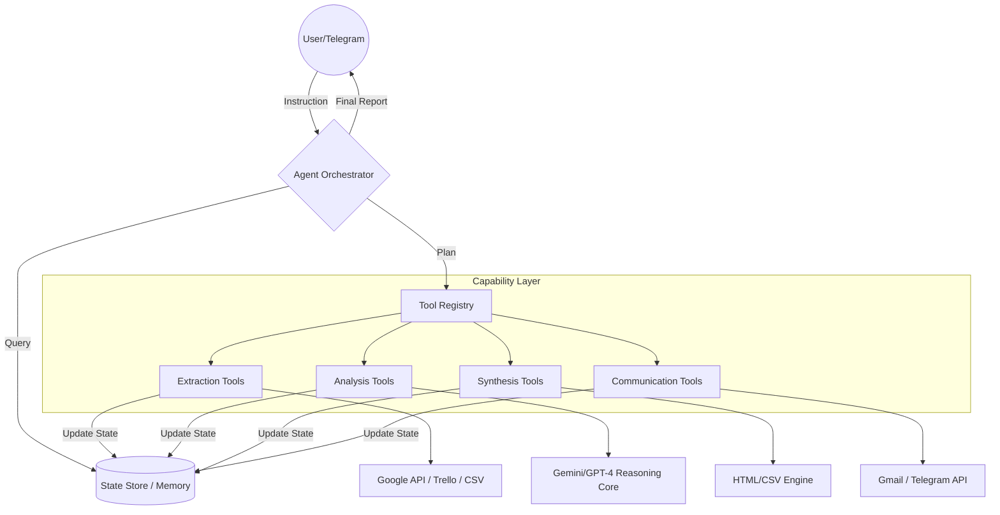

# AI Agent: Autonomous Business Orchestrator


## Vision
The **AI Agent** is not just a set of automation scripts; it is a **SOTA (State-of-the-Art) Agentic System**. It transitions from linear execution to **Goal-Oriented Orchestration**, combining perception, reasoning, and action to manage business operations, SEO positioning, and financial health autonomously.

---

## Agentic Architecture

The system is built on a modular, closed-loop architecture that separates intelligence from execution.



### Core Modules (`core/`)

| Module | Function |
| :--- | :--- |
| `ai_agent.py` | `AgentOrchestrator`: executes the **Perceive → Plan → Act → Evaluate** loop. |
| `ai_engine.py` | LLM reasoning core (Gemini / GPT-4) for planning and natural-language goals. |
| `state.py` | Persistent state (`data/state.json`): the agent remembers progress across sessions. |
| `tools.py` | Central tool registry for dynamic capability discovery. |
| `integrations.py` | Google (Sheets, Gmail, **Search Console**, GA4), Trello, Gmail SMTP/IMAP and Telegram wrappers. |
| `services.py` | Shared business services layer used by campaigns and skills. |
| `lead.py` | Lead model and industry classification (legal, accounting, real-estate, etc.). |
| `telemetry.py` | Consolidated activity telemetry across the whole system. |
| `logger.py` / `paths.py` | Structured logging and canonical path resolution. |

Root helpers: `db_utils.py` (SQLite utilities), `pipeline_base.py` (base class for all scraping/import pipelines).

---

## Features & Functions

### 1. Autonomous Agentic Core
*   **Goal-Oriented Orchestration**: natural-language goals via Telegram → automatic planning and execution.
*   **Perceive → Plan → Act → Evaluate** closed loop with persistent memory across sessions.
*   **Dynamic Tool Registry**: capabilities are discovered and chained at runtime.
*   **Skill Library**: **110 specialized skills** (Markdown + YAML frontmatter) across 5 packs: Core Web, E-commerce, Growth, DevOps, Business Ops.
*   **Scheduled Execution**: Windows Task Scheduler integration (`setup_windows.ps1`, Mon/Wed/Fri) plus 24/7 Telegram listener mode.
*   **Telemetry & Reporting**: consolidated system activity reports.

### 2. Email Marketing Engine (`scripts/e-mail/`)
*   **Multi-account SMTP rotation**: 12 Gmail accounts, BCC batching (50/batch), thread-aware sending.
*   **Geo-targeted campaign senders**: dedicated engines for Lanús, CABA/Buenos Aires and AMBA zones, plus national "valid emails" campaigns.
*   **Failure retry engine**: automatic re-send of bounced/failed deliveries (`campaign_sender_retry_fallos`).
*   **No-contact follow-ups**: `campaign_no_contactados` re-engagement campaigns.
*   **Campaign engine & launcher**: segmentation by list/country, drip and scheduled execution (`gmail_scheduler`, `scheduler_monday`).
*   **IMAP Lead Detection Bot**: monitors inboxes, detects new senders and imports them into the contacts database.
*   **Remarketing Engine**: behavioral re-targeting of past leads.
*   **Gmail reporting**: delivery/open stats and immediate campaign reports.
*   **5-CSV Gmail pipeline**: generates destinatarios / remitentes / pendientes / campañas / delivery-status CSVs.
*   **Email validation & list quality**: MailboxValidator integration, MX checks, health scoring of lists.

### 3. Lead Prospecting & Contacts Database (`scripts/database/`)
*   **Google Maps / SERP scraping pipelines** with keyword × location seed combination.
*   **Multi-source importers**: Gosom batches, LinkedIn profiles, vCard, XLSX, Google Contacts, Mailrelay, phone contacts, RRHH lists.
*   **Deduplication**: email/XLSX duplicate removal and identity-map consolidation.
*   **Enrichment suite**: campaign enrichment, log enrichment, lawyer (`abogados`) enrichment, Lanús campaign enrichment, validation enrichment.
*   **Verification**: SMTP/MX fast verification, blacklist import, Buenos Aires geolocation validation.
*   **Batch generation**: contact batch splitting for multi-account sending.
*   **Audits & stats**: full DB audit, campaign data/date checks, recent-campaign checks.
*   **Visual Contact Editor**: Streamlit CRUD app over the SQLite contacts database.

### 4. SEO & Indexing Automation (`scripts/seo/`, `scripts/campaign/`)
*   **GSC Indexing Fixer** (`gsc_indexing_fixer.py`): iterates **every property** of the Search Console account, audits sitemaps and URLs via the URL Inspection API, classifies each URL (indexable / noindex / 404 / 5xx / duplicate), **re-submits broken sitemaps** and **requests indexing** for eligible pages respecting per-site quota. Outputs Markdown + JSON before/after reports. Dry-run mode included.
*   **Google Search Console + GA4 integration**: clicks, impressions, CTR, top queries straight from the API.
*   **Deep SEO Audit campaign**: automated technical health checks for professional domains.
*   **SEO Content Generator**: automatic SEO-optimized article generation with keyword plan.
*   **Keywords manager**: keyword research and organization for campaigns.
*   **SEO Verifier & Site Mapper**: post-deploy verification and full site structure mapping.
*   **Long-tail Keyword Crawler**: Google + Bing SERP scrapers with Selenium fallback and local-competitor investigation.

### 5. Crawlers & Competitive Intelligence (`scripts/crawler/`)
*   **WordPress SEO Crawler**: extracts SEO metrics, content structure and technical signals from WordPress sites.
*   **E-commerce Competitive Research**: competitor price, catalog and positioning scraping.
*   **Directory Scraping**: Kompass / Páginas Amarillas business-data extraction.
*   **Smart Research Assistant**: market/trend deep research with HTML and PDF report generation.
*   **Web Screenshots**: bulk visual capture of prospect sites.
*   **HTML Report Generator**: professional HTML reporting for any analysis pipeline.

### 6. AI Campaign Studio (`scripts/campaign/`)
*   **Ad Studio**: AI-generated ad copy at scale with brand loader, prompt builder, typography rules and batch/final generators.
*   **AI Ads Campaign**, **AI Email Marketing Campaign**, **AI Automation Campaign**: LLM-driven campaign orchestration.
*   **Financial Campaign**: automated financial reporting communications.
*   **Productivity Campaign**: personalized productivity briefs by email.
*   **SEO Campaign** and **WP Pages Campaign**: SEO and WordPress page generation campaigns.
*   **Online Store Catalog Campaign**: catalog-driven promotional campaigns.
*   **WordPress Chatbot Campaign**: automated chatbot-based lead capture.
*   **Campaign UI**: unified interface to launch and monitor every campaign type.

### 7. WhatsApp & Social RPA (`scripts/rpa_whatsapp/`)
*   **WhatsApp Web RPA**: Playwright automation of message sending without the official API, with CDP mode for persistent sessions.
*   **Number parser**: extracts and normalizes phone numbers from arbitrary sources.
*   **Session health checks**: automatic detection of input/search elements and QR login helpers.

### 8. Finance & Accounting Intelligence (`scripts/finance/accountly/`)
*   **PDF data extraction** from ARCA (ex-AFIP), Santander and MercadoPago statements.
*   **Processors & generators**: normalize transactions and produce professional HTML accounting reports.
*   **Goal tracking**: daily, weekly and monthly revenue targets with dynamic progress bars.

### 9. WooCommerce Catalog Sync (`scripts/woocommerce_sync/`)
*   **Product catalog synchronization** between WooCommerce stores (light and final modes).
*   **Diagnostics & auth debugging**: connectivity and permission checks before sync runs.

### 10. Meta Ads Campaign Manager (`scripts/meta_ads/`)
*   **Config-driven Marketing API client**: campaigns, ad sets and click-to-WhatsApp ads are created from a JSON file; the code is business-agnostic and all credentials live only in `.env`.
*   **Full lifecycle CLI**: `doctor` (token/ad accounts/Pages audit), `resolve-geo` (targeting search), `validate` (offline checks plus API `validate_only` preflight), `create` (PAUSED by default), `status`, `set-status` and `exchange` (long-lived token helper).
*   **Targeting builder**: coordinates/address/city targeting (1-80 km radius), age and gender ranges, device platforms.
*   **Ad scheduling (day-parting)**: day-of-week and hour windows with automatic daily-to-lifetime budget fallback, account currency offset handling and an expected-currency guard.
*   **Creatives**: local images converted to 1:1 JPEG via Pillow and uploaded through the API, with the WhatsApp call-to-action wired to the number linked to the Page.

### 11. Platform Integrations
*   **Google**: Sheets, Gmail (SMTP + IMAP drafts), Search Console, GA4, Calendar.
*   **Trello**: board/list/card reading for project tracking.
*   **Telegram**: 24/7 bot listener and reporting channel.
*   **Cloudflare / Astro stack**: alignment with Cloudflare Pages/Functions, Resend and Turnstile for web delivery.

### 12. Financial Intelligence (Contable)
*   **Autonomous Analysis**: reads real-time earnings from CSVs.
*   **Goal Tracking**: calculates daily, weekly and monthly targets.
*   **Visual Reporting**: professional HTML reports with dynamic progress bars.

### 13. Productivity Orchestration (Trabajo)
*   **Trello Sync**: monitors "In Progress" cards to track real-time output.
*   **Google Sheets Integration**: syncs high-level objectives with daily execution.
*   **Automated Briefs**: sends personalized productivity summaries via email.

---

## Security & Configuration

*   **Secrets**: all tokens and API keys reside exclusively in the `.env` file (excluded from Git via `.gitignore`).
*   **References**: `LLM_PROVIDERS.md` functions as a technical reference document without sensitive data.
*   **Rules**: `ENRICH_RULES.md` (data validation and lead cleaning), `AGENTS.md` (agent roles and MCP servers), `ESTEBAN.md` (ecosystem utility map), `WINDOWS_SCHEDULED_TASKS.md` (task scheduling reference).

---

## Installation & Setup

### 1. Prerequisites
- Python 3.10+
- Google Cloud credentials (Service Account JSON or OAuth Client Secret for Search Console indexing actions)
- Trello API Key & Token
- Gmail App Password

### 2. Quick Start
```bash
# Clone the repository
git clone https://github.com/selvaggiesteban/AI_Agent.git
cd AI_Agent

# Setup environment variables
cp .env-example .env
# Edit .env with your real credentials

# Install dependencies
pip install pandas google-api-python-client google-auth-oauthlib pytrello requests google-generativeai playwright pillow
```

### 3. Execution Modes

| Mode | Command | Description |
| :--- | :--- | :--- |
| **Interactive** | `python core/ai_agent.py --listen` | 24/7 Telegram listener for natural language goals. |
| **Immediate** | `python core/ai_agent.py --now` | Runs a general system health check immediately. |
| **Scheduled** | `.\setup_windows.ps1` | Programs Windows Task Scheduler (Mon, Wed, Fri). |
| **GSC Indexing Fix** | `python scripts/seo/gsc_indexing_fixer.py` | Audits all Search Console sites and fixes indexing (use `--dry-run` first). |
| **Meta Ads** | `python -m scripts.meta_ads doctor` | Health check for the Marketing API token, ad accounts and Pages (see `scripts/meta_ads/README.md`). |

---

## Project Conventions
The agent operates under a strict framework of professional rules:
- **`AGENTS.md`**: Inventory of agent roles and MCP servers.
- **`ENRICH_RULES.md`**: Data validation and lead cleaning rules.
- **`ESTEBAN.md`**: Technical references and ecosystem utility map.

## Legal Notice
This project is applicable before the **Agencia de Recaudación y Control (ARCA)** (formerly AFIP), with validity as of August 2026.
